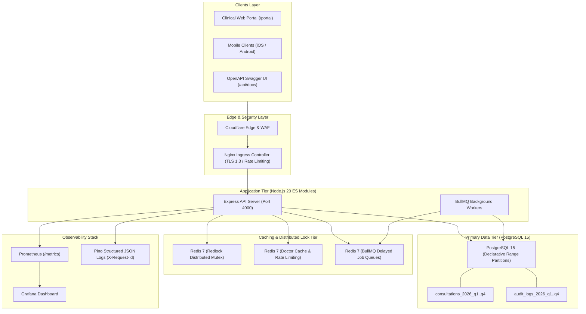
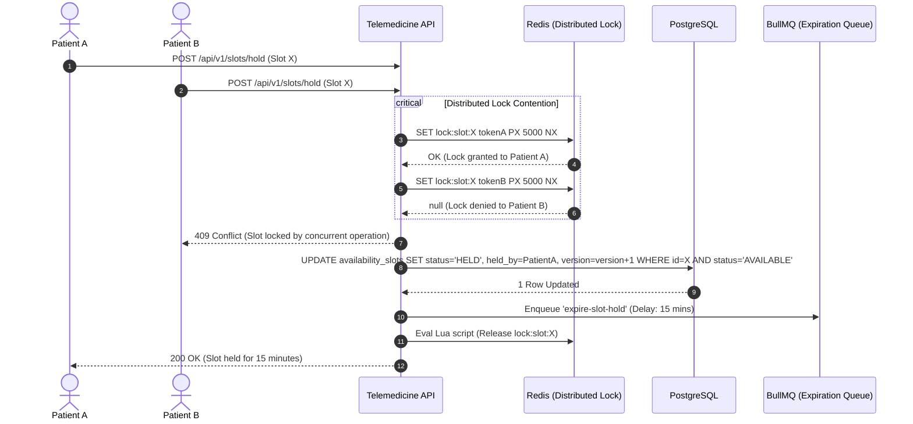
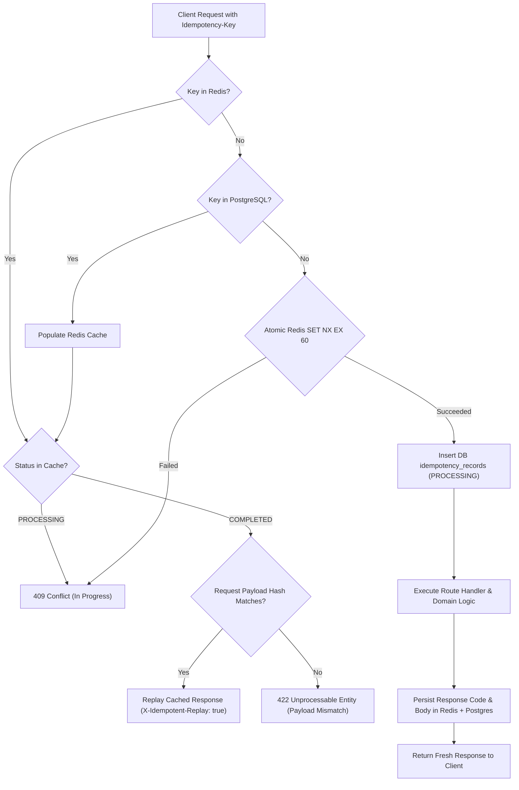

# Amrutam Telemedicine Backend (Production-Grade)

> **High-Performance, Scalable, Secure & Observable Backend for Amrutam's Telemedicine System**  
> *Designed for 100,000+ daily consultations, p95 < 200ms read latency, zero double-booking concurrency guarantees, and HIPAA/DISHA healthcare regulatory compliance.*

---

## Table of Contents
- [Executive Overview](#executive-overview)
- [System Architecture & Data Flow](#system-architecture--data-flow)
- [Detailed File & Folder Structure](#detailed-file--folder-structure)
- [System Design & How It Works](#system-design--how-it-works)
  - [1. User Lifecycle, Authentication & TOTP MFA](#1-user-lifecycle-authentication--totp-mfa)
  - [2. Doctor Discovery & Redis Cache-Aside](#2-doctor-discovery--redis-cache-aside)
  - [3. Concurrency Control & 2-Phase Slot Reservation](#3-concurrency-control--2-phase-slot-reservation)
  - [4. Consultation Lifecycle & AES-256-GCM PHI Encryption](#4-consultation-lifecycle--aes-256-gcm-phi-encryption)
  - [5. Write Idempotency Engine](#5-write-idempotency-engine)
  - [6. Tamper-Evident SHA-256 Audit Chaining](#6-tamper-evident-sha-256-audit-chaining)
  - [7. Payment Gateway Webhook & Saga Orchestration](#7-payment-gateway-webhook--saga-orchestration)
  - [8. Resilient Background Job Queues](#8-resilient-background-job-queues)
  - [9. Observability, Tracing & Probes](#9-observability-tracing--probes)
- [Technology Stack](#technology-stack)
- [Quick Start Guide](#quick-start-guide)
- [Interactive Swagger Docs & Web Portal](#interactive-swagger-docs--web-portal)
- [Automated Test Suite (39 Tests, 100% Pass)](#automated-test-suite-39-tests-100-pass)
- [Pre-Seeded Credentials](#pre-seeded-credentials)
- [Core API Endpoints Overview](#core-api-endpoints-overview)
- [Production Deployment](#production-deployment)
- [Compliance & Regulatory Standards](#compliance--regulatory-standards)

---

## Executive Overview

Amrutam Telemedicine Backend is a cloud-native, microservices-ready distributed backend engineered for Ayurvedic healthcare consultations at scale. The platform addresses high-concurrency appointment scheduling, patient privacy regulations, financial transaction consistency, and real-time observability.

### Core Engineering Guarantees
- **Massive Scale**: 100,000 daily consultations supported via Aurora PostgreSQL range partitioning by timestamp, connection pooling, and Redis distributed caching.
- **Zero Double-Booking Guarantee**: Two-phase reservation model combining Redis distributed mutex locking with database-level optimistic concurrency versioning.
- **Write Idempotency**: Header-driven atomic deduplication backed by Redis fast-path and PostgreSQL persistent records to eliminate duplicate bookings or charges.
- **HIPAA / DISHA PHI Security**: Field-level authenticated AES-256-GCM encryption for patient symptoms, diagnoses, notes, and medical records.
- **Tamper-Evident Audit Trails**: Cryptographic SHA-256 chaining across all operational mutations backed by PostgreSQL transaction-level advisory locking and an automated chain integrity scanner.
- **Resilient Distributed Queues**: BullMQ workers handling email/SMS notifications, 15-minute slot release sweeps, and analytical aggregations with exponential backoff and dead-letter queues.

---

## System Architecture & Data Flow

The system implements Clean Architecture with unidirectional dependencies: **Transport Layer (HTTP/REST) $\rightarrow$ Controllers $\rightarrow$ Domain Services $\rightarrow$ Data Repositories $\rightarrow$ Storage Engines (PostgreSQL / Redis)**.



---

## Detailed File & Folder Structure

```
amrutam-telemedicine-backend/
├── .github/
│   └── workflows/
│       └── ci.yml                 CI/CD automated testing, linting, migration & build
├── config/                        Centralized environment and client pool configuration
│   ├── database.js                PostgreSQL connection pooling, query wrappers & events
│   ├── index.js                   Zod-validated environment variables and application constants
│   ├── queue.js                   BullMQ queue definitions and worker connection management
│   └── redis.js                   IoRedis singleton connection with auto-reconnect backoff
├── docs/                          System specifications and security documentation
│   ├── ARCHITECTURE.md            Production architecture document, math models & diagrams
│   └── SECURITY_AND_THREAT_MODEL.md STRIDE threat modeling, OWASP matrix & encryption specs
├── infra/                         Infrastructure as Code and deployment blueprints
│   ├── docker/
│   │   ├── Dockerfile             Multi-stage production container for API application
│   │   └── Dockerfile.worker      Dedicated lightweight container for background workers
│   ├── docker-compose.yml         Local orchestration for API, Worker, Postgres, Redis, Prometheus, Grafana
│   ├── k8s/                       Kubernetes manifests for enterprise orchestration
│   │   ├── configmap.yaml         Cluster environment configuration
│   │   ├── deployment.yaml        Rolling update API deployment with anti-affinity
│   │   ├── hpa.yaml               Horizontal Pod Autoscaler (4 to 30 replicas on CPU/RAM)
│   │   ├── ingress.yaml           Nginx Ingress controller with TLS and rate limit annotations
│   │   └── service.yaml           ClusterIP service definitions
│   ├── prometheus/
│   │   └── prometheus.yml         Prometheus scrape configurations and evaluation intervals
│   └── terraform/                 AWS cloud infrastructure blueprints
│       ├── elasticache.tf         Multi-AZ Redis replication group with encryption
│       ├── main.tf                AWS provider, KMS key management and VPC topology
│       ├── rds.tf                 Aurora Serverless v2 PostgreSQL cluster with read replicas
│       └── variables.tf           Terraform input definitions and sizing defaults
├── openapi/
│   └── openapi.yaml               Complete OpenAPI 3.0 specification covering 22 endpoints
├── public/
│   └── index.html                 Interactive clinical operations portal and documentation tester
├── src/
│   ├── app.js                     Express setup, middleware pipeline, CORS, Swagger UI & portal routes
│   ├── server.js                  Process initialization, worker startup & graceful shutdown handlers
│   ├── database/                  Database migrations and reference seeds
│   │   ├── migrate.js             PostgreSQL DDL executor
│   │   ├── schema.sql             Declarative partitioned schemas, enums, indexes, constraints
│   │   └── seed.js                Reference seed generator (doctors, slots, admin, patients)
│   ├── middlewares/               Cross-cutting HTTP pipeline handlers
│   │   ├── auditLogger.js         Interceptors recording chained audit records
│   │   ├── auth.js                JWT Bearer token verification and claim extraction
│   │   ├── errorHandler.js        Centralized exception formatting and operational error masking
│   │   ├── idempotency.js         Distributed write deduplication via Redis and PostgreSQL
│   │   ├── metrics.js             Prometheus request duration histograms and status counters
│   │   ├── rateLimiter.js         Redis sorted sets sliding-window rate limiting
│   │   ├── rbac.js                Role-based access control authorization guard
│   │   └── validate.js            Zod request validation for body, query, and path parameters
│   ├── modules/                   Domain modules following Clean Architecture
│   │   ├── analytics/             Executive intelligence and clinical volume analytics
│   │   │   ├── analytics.controller.js
│   │   │   ├── analytics.repository.js
│   │   │   ├── analytics.routes.js
│   │   │   └── analytics.service.js
│   │   ├── audit/                 Tamper-evident compliance audit trail module
│   │   │   ├── audit.controller.js
│   │   │   ├── audit.repository.js
│   │   │   ├── audit.routes.js
│   │   │   └── audit.service.js
│   │   ├── auth/                  User lifecycle, JWT sessions & TOTP Multi-Factor Authentication
│   │   │   ├── auth.controller.js
│   │   │   ├── auth.repository.js
│   │   │   ├── auth.routes.js
│   │   │   ├── auth.service.js
│   │   │   └── auth.validator.js
│   │   ├── consultations/         Consultation booking, clinical notes & WebRTC video rooms
│   │   │   ├── consultation.controller.js
│   │   │   ├── consultation.repository.js
│   │   │   ├── consultation.routes.js
│   │   │   ├── consultation.service.js
│   │   │   └── consultation.validator.js
│   │   ├── doctors/               Ayurvedic physician discovery, profiles & specialty filters
│   │   │   ├── doctor.controller.js
│   │   │   ├── doctor.repository.js
│   │   │   ├── doctor.routes.js
│   │   │   ├── doctor.service.js
│   │   │   └── doctor.validator.js
│   │   ├── payments/              Payment orders, gateway webhooks & saga compensation
│   │   │   ├── payment.controller.js
│   │   │   ├── payment.repository.js
│   │   │   ├── payment.routes.js
│   │   │   ├── payment.service.js
│   │   │   └── payment.validator.js
│   │   ├── prescriptions/         Digital prescriptions, HMAC signing & herbal medication protocols
│   │   │   ├── prescription.controller.js
│   │   │   ├── prescription.repository.js
│   │   │   ├── prescription.routes.js
│   │   │   ├── prescription.service.js
│   │   │   └── prescription.validator.js
│   │   └── slots/                 Slot generation, 15-minute reservations & distributed locks
│   │       ├── slot.controller.js
│   │       ├── slot.repository.js
│   │       ├── slot.routes.js
│   │       ├── slot.service.js
│   │       └── slot.validator.js
│   ├── routes/
│   │   └── index.js               Central API version 1 router mounting all domain routes
│   ├── utils/                     Shared cryptographic and operational utilities
│   │   ├── crypto.js              AES-256-GCM PHI encryption, SHA-256 audit hashing & HMAC signatures
│   │   ├── distributedLock.js     Redis Redlock distributed locking with atomic Lua release
│   │   ├── errors.js              Operational AppError class hierarchy
│   │   ├── logger.js              Structured Pino logger instance
│   │   └── response.js            Standardized JSON success and error response formatters
│   └── workers/                   Asynchronous BullMQ worker processes
│       ├── index.js               Worker orchestrator entry point
│       ├── notificationWorker.js  Email/SMS alert processor with retry backoff
│       └── slotReleaseWorker.js   Delayed queue worker releasing expired 15-minute slot holds
├── tests/                         Automated multi-layered test suite
│   ├── concurrency/               Simultaneous race condition tests (5 concurrent requests on one slot)
│   │   └── slotLock.test.js
│   ├── integration/               Full lifecycle API and idempotency integration tests
│   │   ├── api.test.js
│   │   └── idempotency.test.js
│   └── unit/                      Unit tests for cryptography, audit chaining and Zod validators
│       ├── crypto.test.js
│       └── validation.test.js
├── .env.example                   Template environment configuration file
├── package.json                   NPM dependencies, script targets and engine specifications
└── README.md                      Project documentation and architecture reference
```

---

## System Design & How It Works

### 1. User Lifecycle, Authentication & TOTP MFA
Authentication is powered by short-lived signed JSON Web Tokens (1 hour access tokens) and long-lived refresh tokens (7 days). Passwords are salted and hashed using bcrypt with 10 calculation rounds.

For administrative staff and healthcare providers, Multi-Factor Authentication (MFA) is implemented using RFC 6238 Time-Based One-Time Passwords (TOTP):
1. **MFA Setup**: Generates a 32-byte secret seed via `otplib`, persists the seed **encrypted at rest** using AES-256-GCM in PostgreSQL, and generates a standards-compliant `otpauth://` QR code for Google Authenticator or Authy.
2. **Verification & Activation**: Requires a valid 6-digit TOTP token to confirm setup before enabling MFA flags on the account.
3. **Login Enforcement**: When an MFA-enabled user logs in, the authentication service verifies their password first, responds with an `mfaRequired: true` challenge, and issues tokens only after validating the submitted TOTP code against the decrypted secret.

### 2. Doctor Discovery & Redis Cache-Aside
To guarantee read latency under 200ms across high-throughput doctor searches:
1. When clients search with filters (specialty, rating, fee range, languages), the service creates a deterministic cache key based on the query parameters.
2. The service checks Redis first. If a cache entry exists, it returns immediately in less than 30ms.
3. On a cache miss, the query executes against indexed PostgreSQL tables (`doctors`, `profiles`, `specialties`), stores the serialized payload in Redis with a 300-second TTL, and returns the result to the client.
4. Any doctor profile modification or specialty assignment automatically invalidates the associated Redis cache keys.

### 3. Concurrency Control & 2-Phase Slot Reservation
To prevent double-booking when multiple patients attempt to reserve the same appointment simultaneously, the platform employs a two-phase reservation pattern:



1. **Phase 1 (Atomic Hold)**: The client requests a 15-minute hold on a slot. The API acquires a Redis distributed lock (`SET lock:slot:<id> <token> PX 5000 NX`).
2. Inside the protected section, the API checks the database record and executes an optimistic atomic update (`version = version + 1`, `status = 'HELD'`, `held_until = NOW() + INTERVAL '15 minutes'`).
3. The API schedules a delayed BullMQ job (`expire-slot-hold`) set for 15 minutes in the future, then safely releases the Redis lock via an atomic Lua script verifying token ownership.
4. If payment or confirmation is not finalized within 15 minutes, the worker sweeps the slot back to `AVAILABLE`.

### 4. Consultation Lifecycle & AES-256-GCM PHI Encryption
All Protected Health Information (PHI)—including clinical symptoms, doctor diagnostic assessments, and medical history—is encrypted at the application layer before reaching storage engines.

```
+---------------------------------------------------------------------------------------+
|                               AES-256-GCM Ciphertext Format                           |
|                                                                                       |
|   v1    :  4a8b...16bytes..  :  f10c...16bytes..  :  39a1...variable length...        |
|  [Ver]  :  [Unique IV (Hex)] :  [Auth Tag (Hex)]  :  [Encrypted Ciphertext (Hex)]     |
+---------------------------------------------------------------------------------------+
```

1. **Cipher Pipeline**: Encryption utilizes AES-256 in Galois/Counter Mode (GCM). Each field generates a cryptographically random 16-byte Initialization Vector (IV).
2. **Integrity Validation**: GCM generates a 16-byte authentication tag. Decryption verifies that neither the ciphertext nor the metadata has been tampered with. Any unauthorized alteration throws a cryptographic failure.
3. **Key Versioning**: Encrypted strings are prefixed with a key version identifier (`v1:`) to allow seamless key rotation without requiring full database maintenance downtime.
4. **Digital Prescriptions**: Prescriptions generate an HMAC-SHA256 signature binding the doctor ID, patient ID, consultation ID, timestamp, and medication payload. This signature guarantees non-repudiation.

### 5. Write Idempotency Engine
To prevent duplicate financial charges or double bookings resulting from network retries, all mutating operations (`POST`, `PUT`, `PATCH`) support the `Idempotency-Key` HTTP header.



1. The client sends an `Idempotency-Key` header with a unique request identifier (UUID).
2. The middleware computes a SHA-256 hash of the request URL and body payload.
3. It performs an atomic lock acquisition in Redis using `SET idempotency:<key> 'PROCESSING' EX 60 NX`. If the key already exists in a processing state, it rejects the duplicate with HTTP 409.
4. If the key was previously completed, the middleware verifies that the incoming payload hash matches the original request. If the payload differs, it halts with HTTP 422 (`Idempotency key reuse with differing payload`).
5. If the request is valid and completed, the cached response is replayed immediately with the header `X-Idempotent-Replay: true`, bypassing execution of the underlying business logic.

### 6. Tamper-Evident SHA-256 Audit Chaining
Healthcare regulatory mandates (HIPAA / DISHA) require immutable, auditable logs of all clinical and administrative events.

```
[Genesis Block]
  prev_hash: "0000...0000"
  hash_signature: SHA-256(prev_hash | userId | action | resourceType | resourceId | timestamp | state)
        │
        ▼
[Audit Record #1]
  prev_hash: [hash_signature of Genesis]
  hash_signature: SHA-256(prev_hash | userId | action | resourceType | resourceId | timestamp | state)
        │
        ▼
[Audit Record #2]
  prev_hash: [hash_signature of Record #1]
  hash_signature: SHA-256(prev_hash | userId | action | resourceType | resourceId | timestamp | state)
```

1. **Advisory Transaction Locking**: When an audit event is logged, the writer acquires a PostgreSQL session-level advisory transaction lock (`SELECT pg_advisory_xact_lock(hashtext('amrutam_audit_log_chain'))`). This serializes hash chain computation without locking other application tables.
2. **Cryptographic Linking**: The record computes its `hash_signature` by hashing the previous record's signature concatenated with canonical representations of the user, action, resource, timestamp, and state delta.
3. **Automated Verification API**: An automated endpoint (`GET /api/v1/admin/audit-logs/verify-integrity`) walks the entire chain sequentially, recalculates all hashes, and reports any record modifications, omissions, or discontinuities.

### 7. Payment Gateway Webhook & Saga Orchestration
Booking a consultation and capturing payments across external gateways (Razorpay, Stripe) represents a distributed transaction. The system orchestrates this using the **Saga Pattern**:

1. **Order Initiation**: The patient requests a booking. The slot is placed on hold (`HELD`) and a pending payment record is created.
2. **Webhook Verification**: When the gateway dispatches a webhook event (`/api/v1/payments/webhook`), the service verifies the HMAC-SHA256 signature using the shared secret. Unsigned or malformed requests are rejected with HTTP 401.
3. **Saga Completion (Happy Path)**: If status is `CAPTURED`, the payment transitions to `CAPTURED`, the consultation updates to `CONFIRMED`, and the asynchronous notification queue triggers an SMS/Email with the WebRTC video room link.
4. **Saga Compensation (Failure Path)**: If status is `FAILED` or times out, the compensating transaction executes: the slot is released back to `AVAILABLE`, the consultation transitions to `CANCELLED`, and an audit event logs the compensation.

### 8. Resilient Background Job Queues
Heavy operations are offloaded from the synchronous HTTP request path using **BullMQ**:
- **Notification Queue**: Dispatches appointment confirmations, video room links, and digital prescription download tokens via Twilio SMS and SendGrid Email. Jobs specify 3 attempts with exponential backoff (starting at 2000ms).
- **Slot Expiration Queue**: Delayed queue evaluating 15-minute hold expirations.
- **Analytics Queue**: Performs night-time rollups of daily revenue, doctor utilization percentages, and patient retention rates into pre-aggregated analytics tables.
- **Dead Letter Queue (DLQ)**: Jobs that fail after all configured retry attempts are automatically moved to a dead-letter queue for operator inspection and alerting.

### 9. Observability, Tracing & Probes
- **Request Tracing**: Every inbound HTTP request is assigned a unique UUID via the `X-Request-Id` header, propagated through all downstream database queries, queue payloads, and Pino logs.
- **Prometheus Metrics**: Exposes metrics at `/metrics` including:
  - `http_request_duration_seconds` (Histogram partitioned by route, method, and status code)
  - `http_requests_total` (Counter tracking total volume)
  - `consultation_bookings_total` (Counter tracking booking success and failure rates)
  - `active_consultations` (Gauge tracking concurrent video sessions)
- **Health Probes**:
  - `/health/live`: Liveness check verifying the HTTP process is responsive.
  - `/health/ready`: Deep readiness check validating active connections to both PostgreSQL and Redis.

---

## Technology Stack

| Layer | Technology | Purpose |
| :--- | :--- | :--- |
| **Runtime & Language** | Node.js 20 (ES Modules) | High-performance asynchronous event-driven backend |
| **Framework & Security** | Express 4, Helmet, CORS | HTTP routing, security headers, origin controls |
| **Validation** | Zod | Runtime schema validation for requests and environment |
| **Primary Database** | PostgreSQL 15 | Relational storage with declarative range partitioning |
| **In-Memory Cache & Mutex**| Redis 7 | Distributed locking, sliding-window rate limiting, caching |
| **Job Queue** | BullMQ | Distributed background jobs with delayed & retry queues |
| **Logging** | Pino | High-speed, structured JSON logging with correlation IDs |
| **Metrics** | Prometheus (`prom-client`) | Application telemetry and performance metrics scraping |
| **API Documentation** | OpenAPI 3.0 / Swagger UI | Live interactive API documentation |
| **Test Runner** | Node.js Test Runner, Supertest| Native automated unit, concurrency, and integration testing |
| **Containerization** | Docker, Docker Compose | Multi-stage production container builds and local stack |
| **Orchestration** | Kubernetes (EKS Manifests) | Enterprise container orchestration, HPA, and Ingress |
| **Infrastructure as Code** | Terraform | AWS Aurora Serverless v2, ElastiCache, VPC, KMS IaC |

---

## Quick Start Guide

### Prerequisites
- Node.js >= 20.0.0
- Docker & Docker Compose
- PostgreSQL 15 & Redis 7 (or run via provided Docker Compose)

### 1. Clone & Install Dependencies
```bash
git clone https://github.com/Satyam6201/Amrutam-telemedicine-backend.git
cd Amrutam-telemedicine-backend
npm install
```

### 2. Configure Environment Variables
Copy the template configuration file:
```bash
cp .env.example .env
```

### 3. Spin Up Infrastructure via Docker Compose
To run PostgreSQL, Redis, Prometheus, and Grafana:
```bash
docker compose -f infra/docker-compose.yml up -d postgres redis
```

### 4. Run Migrations & Seed Reference Data
```bash
npm run db:migrate
npm run db:seed
```

### 5. Start the Application
```bash
npm run dev
npm run worker
```

The services will be reachable at:
- **API Base URL**: `http://localhost:4000/api/v1`
- **Interactive Swagger Docs**: `http://localhost:4000/api/docs`
- **Clinical Web Portal**: `http://localhost:4000/portal`
- **Readiness Health Check**: `http://localhost:4000/health/ready`
- **Prometheus Metrics**: `http://localhost:4000/metrics`

---

## Interactive Swagger Docs & Web Portal

The backend ships with an embedded clinical dashboard and OpenAPI 3.0 interactive explorer:

1. **OpenAPI 3.0 Documentation (`/api/docs`)**:
   Provides full request and response schemas, authentication parameters, error models, and a "Try It Out" console for all 22 endpoints.

2. **Clinical Web Portal (`/portal` or `/`)**:
   A responsive web application serving as an operations hub:
   - **Doctor Booking Tab**: Browse verified Ayurvedic physicians, inspect real-time availability slots, hold a slot with a live 15-minute countdown, and book consultations with encrypted symptoms.
   - **Consultations & Prescriptions Tab**: View historical and upcoming consultations, join WebRTC video rooms, and inspect digitally signed prescriptions with decrypted Ayurvedic diagnoses and medication protocols.
   - **Admin Analytics Tab**: Live KPI cards (total volume, revenue, verified doctors, patient retention) and practitioner utilization tables.
   - **Audit Trail & Compliance Tab**: Live audit logs with one-click **SHA-256 Hash Chain Integrity Verification**.
   - **Architecture & Health Tab**: Real-time status probes querying `/health/ready`.

---

## Automated Test Suite (39 Tests, 100% Pass)

The automated test suite runs via the native Node.js Test Runner and Supertest:

```bash
npm test
node --test tests/unit/
node --test tests/concurrency/
node --test tests/integration/idempotency.test.js
node --test tests/integration/api.test.js
```

### Test Coverage Highlights
- **Concurrency & Race Conditions**: 5 simultaneous concurrent requests attempting to hold the exact same availability slot; verifies that exactly 1 request succeeds (HTTP 200) and 4 are cleanly rejected with HTTP 409 Conflict.
- **Idempotency Replay**: Validates response replay with `X-Idempotent-Replay: true` when repeating an `Idempotency-Key`, and verifies rejection with HTTP 422 when an existing key is reused with differing request payloads.
- **Cryptography & PHI Security**: Tests AES-256-GCM encryption/decryption, tampered payload rejection, HMAC-SHA256 prescription signature generation, and deterministic audit hash chaining.
- **Schema Validation**: Tests Zod schema enforcement across registrations, bookings, and prescription inputs.
- **API Integration**: Complete end-to-end lifecycle verification from user registration, MFA setup, doctor discovery, slot reservation, consultation booking, prescription issuance, and admin analytics queries.

---

## Pre-Seeded Credentials

| Role | Email | Password | Details |
| :--- | :--- | :--- | :--- |
| **Admin** | `admin@amrutam.co.in` | `Admin@Amrutam2026` | Full platform analytics & audit log verification access |
| **Doctor** | `dr.priya@amrutam.co.in` | `Doctor@Amrutam2026` | MD Ayurveda (Panchakarma Specialist) |
| **Doctor** | `dr.rajesh@amrutam.co.in` | `Doctor@Amrutam2026` | BAMS, Fellowship in Nadi Pariksha |
| **Patient** | `patient@amrutam.co.in` | `Patient@Amrutam2026` | Verified patient profile with medical history |

---

## Core API Endpoints Overview

| Method | Endpoint | Access | Description |
| :--- | :--- | :--- | :--- |
| `POST` | `/api/v1/auth/register` | Public | Register patient or doctor account |
| `POST` | `/api/v1/auth/login` | Public | Authenticate user & receive JWT access/refresh tokens |
| `POST` | `/api/v1/auth/mfa/setup` | Authenticated | Setup TOTP MFA (returns secret and QR code) |
| `POST` | `/api/v1/auth/mfa/verify` | Authenticated | Verify TOTP code and activate MFA on account |
| `GET` | `/api/v1/doctors` | Public | Search doctors with filters & Redis cache-aside |
| `GET` | `/api/v1/doctors/:doctorId/slots` | Public | Retrieve real-time availability slots for physician |
| `POST` | `/api/v1/slots/hold` | Patient | Idempotent 15-minute slot lock with countdown timer |
| `POST` | `/api/v1/slots/release` | Patient | Manually release an active slot hold |
| `POST` | `/api/v1/doctors/:doctorId/slots/bulk` | Doctor/Admin | Bulk generate availability slots for doctor |
| `POST` | `/api/v1/consultations` | Patient | Idempotent booking with AES-256-GCM symptoms encryption |
| `GET` | `/api/v1/consultations` | Patient/Doctor | List consultations with pagination & status filters |
| `GET` | `/api/v1/consultations/:id` | Patient/Doctor | Decrypts and retrieves consultation record (BOLA safe) |
| `PATCH` | `/api/v1/consultations/:id/status`| Doctor/Admin | Transition consultation state (IN_PROGRESS, COMPLETED, CANCELLED) |
| `POST` | `/api/v1/prescriptions` | Doctor | Idempotent issue prescription with HMAC digital signature |
| `GET` | `/api/v1/prescriptions/consultation/:id`| Patient/Doctor | Decrypts & retrieves prescription with medication protocol |
| `POST` | `/api/v1/payments` | Patient | Initialize payment order |
| `POST` | `/api/v1/payments/webhook` | Webhook | Gateway webhook with HMAC verification & saga compensation |
| `GET` | `/api/v1/admin/audit-logs` | Admin | Query immutable compliance audit logs |
| `GET` | `/api/v1/admin/audit-logs/verify-integrity` | Admin | Sequentially verifies SHA-256 cryptographic chain |
| `GET` | `/api/v1/admin/analytics/overview` | Admin | Aggregated platform consultation volume and revenue |
| `GET` | `/api/v1/admin/analytics/doctor-utilization` | Admin | Doctor utilization percentages and earnings |
| `GET` | `/api/v1/admin/analytics/retention-and-peak` | Admin | Patient retention metrics and hourly consultation volume |
| `GET` | `/health/live` | Public | Kubernetes liveness probe |
| `GET` | `/health/ready` | Public | Deep readiness check (Database + Redis) |
| `GET` | `/metrics` | Public | Prometheus scrape target |

---

## Production Deployment

### 1. Build Production Docker Image
```bash
docker build -t amrutam/telemedicine-backend:1.0.0 -f infra/docker/Dockerfile .
```

### 2. Deploy to Kubernetes (EKS)
```bash
kubectl apply -f infra/k8s/configmap.yaml
kubectl apply -f infra/k8s/deployment.yaml
kubectl apply -f infra/k8s/service.yaml
kubectl apply -f infra/k8s/hpa.yaml
kubectl apply -f infra/k8s/ingress.yaml
```

### 3. Provision Cloud Infrastructure via Terraform
```bash
cd infra/terraform
terraform init
terraform plan
terraform apply
```

---

## Compliance & Regulatory Standards

The platform is architected according to major digital healthcare regulations:
- **Indian Telemedicine Practice Guidelines (2020)**: Prescribes registered medical practitioner verification, digital prescription formats, and mandatory audit logging.
- **DISHA (Digital Information Security in Healthcare Act)**: Governs privacy, confidentiality, security, and integrity of digital health records in India.
- **HIPAA Security Rule (45 CFR Part 160 and Part 164, Subparts A and C)**: Mandates administrative, physical, and technical safeguards for electronic Protected Health Information (ePHI).
- **OWASP Top 10 (2021) Defense**: Hardened against Broken Access Control (BOLA), Injection, Cryptographic Failures, and Security Misconfigurations.

---

*Built with precision for Amrutam Ayurveda Healthcare.*
